# Water System for Unity URP

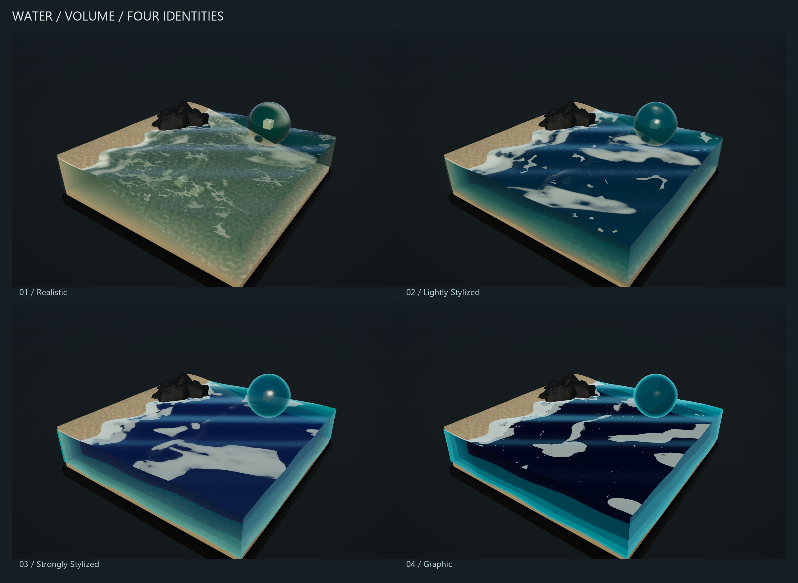

## About the project

Water System is a reusable water material system for Unity's Universal Render Pipeline. It provides water for plane surfaces and closed meshes, with four ready-made visual styles: **Realistic**, **Lightly Stylized**, **Strongly Stylized**, and **Graphic**.

The project brings waves, foam, depth colour, refraction, and caustics into one adjustable material system. You can use a supplied preset, change its appearance in the material Inspector, or edit its Shader Graph. The same set of controls covers the four styles and both mesh types.

It includes two master graphs, 34 shared subgraphs, eight material presets, and renderer support for closed volumes. The system is free to use and modify. Commercial use requires credit to **LazySakana**.

## See it in use

### Water surfaces

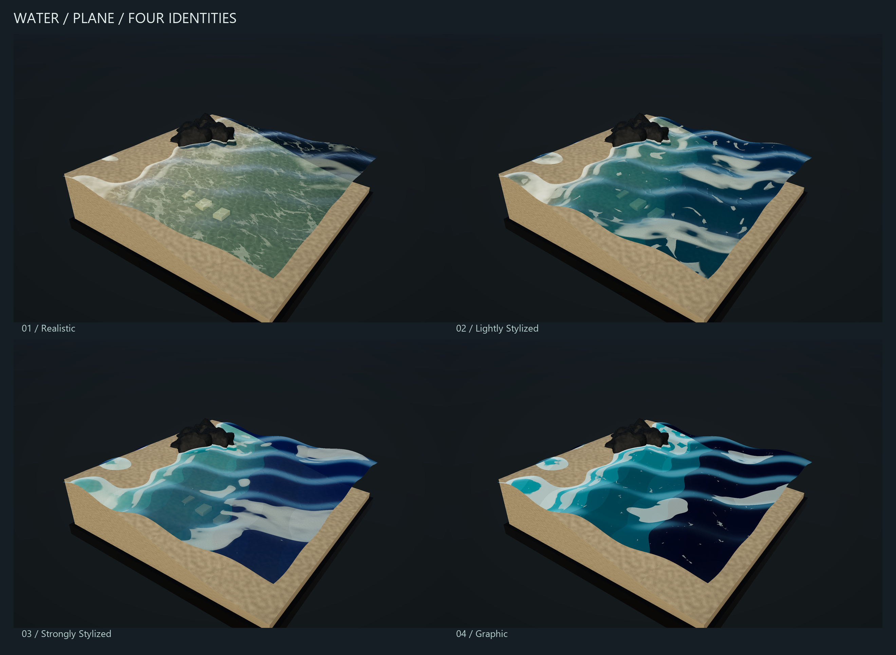

Use the **Plane** material for a water surface with scenery below it. Use the **Volume** material for a separate closed mesh with visible sides. The renders show the volume material on water blocks and curved samples.

| Style | Appearance |
| --- | --- |
| **Realistic** | Detailed foam, transparent shallow water, and soft colour transitions |
| **Lightly Stylized** | Softer detail, simplified foam patches, and visible transmission |
| **Strongly Stylized** | Broad colour shapes and cleaner foam silhouettes |
| **Graphic** | Strong colour separation, stepped shading, and bold foam shapes |

These presets are starting points on a continuous style control. Each style includes a plane material and a volume material.

### Water in motion

| Plane | Volume |
| --- | --- |
| 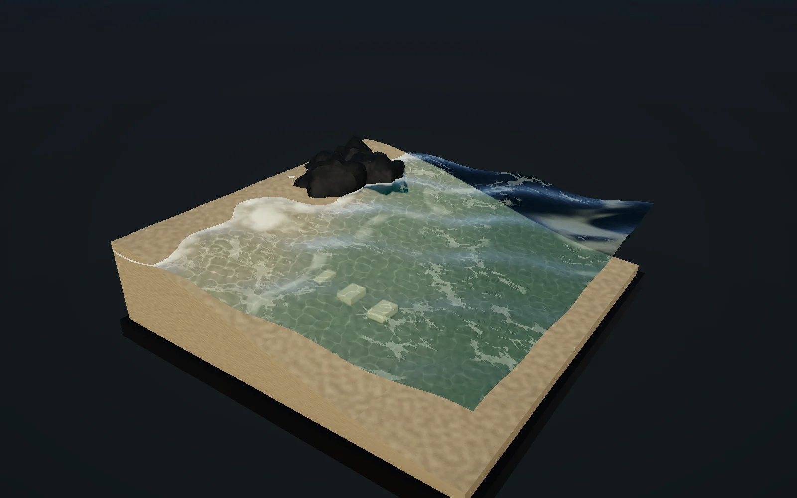 | 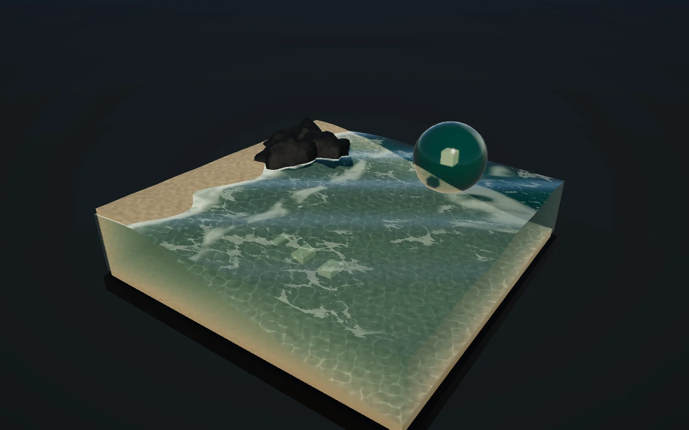 |

### Surface detail and caustics

The Realistic and Lightly Stylized presets use refraction, caustics, and foam bubble bump. Strongly Stylized and Graphic use simpler surface responses. These effects are adjustable in the material Inspector.

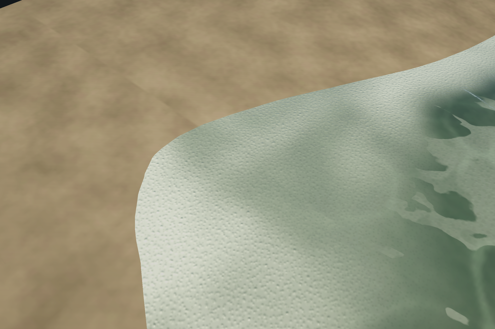

| Caustics disabled | Caustics enabled |
| --- | --- |
|  | 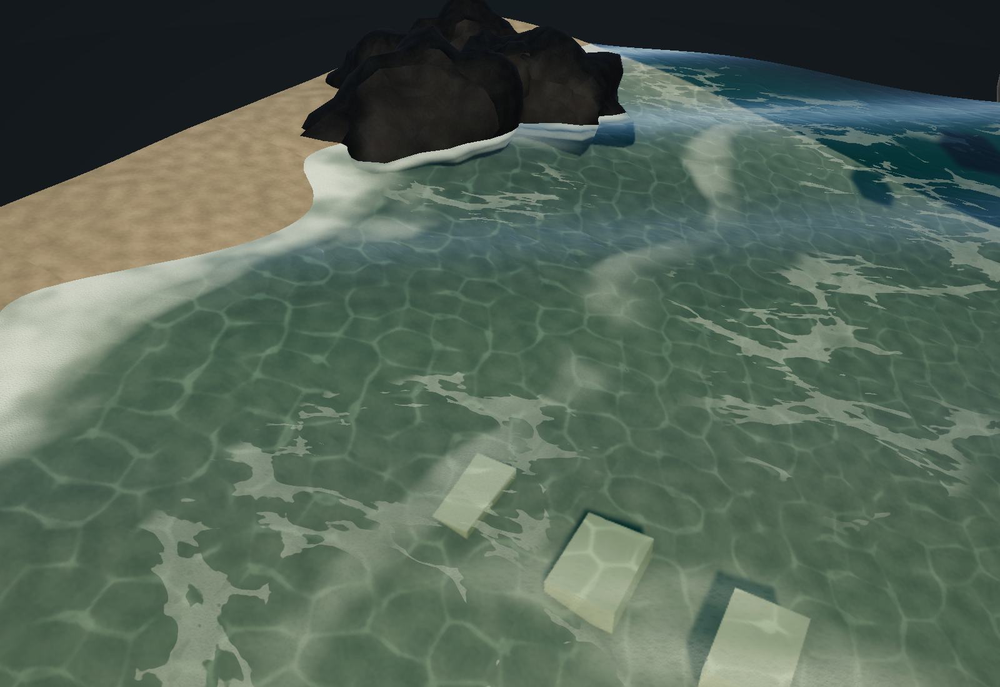 |

## What you can control

| Part of the material | What it changes |
| --- | --- |
| **Waves** | Movement, scale, direction, swell height, and speed |
| **Crest foam** | Foam on wave tops |
| **Surface foam** | Drifting patches across the water |
| **Contact foam** | Foam near shallow intersections with scenery |
| **Coastal foam** | Moving bands in the shallow shoreline zone |
| **Surface detail** | Normal strength, smoothness, foam grain, and bubble bump |
| **Depth and refraction** | Shallow and deep colours, absorption, opacity, and transmitted scenery |
| **Caustics** | Animated light patterns on submerged scenery |
| **Style** | The balance between detailed and graphic shading |

The foam systems have individual enable controls. The Inspector also includes diagnostic views for the foam masks, thickness, normals, body colour, transmission, and caustics. Duplicate a preset before editing it to preserve the supplied example.

## Graph overview

The material system has two main entry points: **SG_Water_Plane** and **SG_Water_Volume**. They assemble shared subgraphs into six labelled groups, keeping the overall material flow in one place.

### Plane master

### Volume master

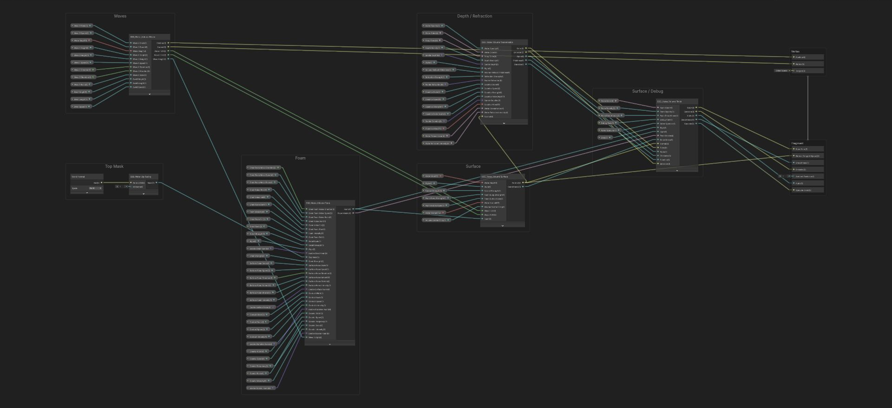

| Group | What belongs here |
| --- | --- |
| **Waves** | Animated movement and mesh displacement |
| **Top Mask** | Where surface effects appear on the mesh |
| **Foam** | The four foam contributions and their shared controls |
| **Surface** | Water normals, bubble detail, and smoothness |
| **Depth / Refraction** | Water colour, transparency, transmitted scenery, and caustics |
| **Surface / Debug** | Final style treatment and diagnostic views |

The smaller subgraphs separate individual effects from the main material flow. For example, the surface foam subgraph groups the controls for coverage, drift, and appearance:

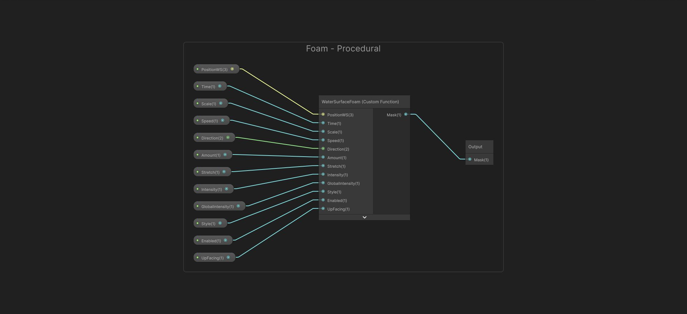

The active masters live in `Assets/Materials/Water/Shader/Masters`. Their shared subgraphs are organized by role under `Subgraphs`. The volume material also uses a renderer feature for its depth support. You can use the presets and Inspector controls without opening the graphs.

## Download a package

Download the ready-made `.unitypackage` files from [GitHub Releases](https://github.com/SakanaLazy/Water_Material_Experimentation/releases/latest). Choose a style package, Graphs Only, or Complete:

| Download | Contents |
| --- | --- |
| [Realistic](https://github.com/SakanaLazy/Water_Material_Experimentation/releases/download/v1.0.0/WaterSystem_Realistic.unitypackage) | Realistic plane and volume presets, with all required shader support |
| [Lightly Stylized](https://github.com/SakanaLazy/Water_Material_Experimentation/releases/download/v1.0.0/WaterSystem_LightlyStylized.unitypackage) | Lightly Stylized plane and volume presets, with all required shader support |
| [Strongly Stylized](https://github.com/SakanaLazy/Water_Material_Experimentation/releases/download/v1.0.0/WaterSystem_StronglyStylized.unitypackage) | Strongly Stylized plane and volume presets, with all required shader support |
| [Graphic](https://github.com/SakanaLazy/Water_Material_Experimentation/releases/download/v1.0.0/WaterSystem_Graphic.unitypackage) | Graphic plane and volume presets, with all required shader support |
| [Graphs Only](https://github.com/SakanaLazy/Water_Material_Experimentation/releases/download/v1.0.0/WaterSystem_GraphsOnly.unitypackage) | Both masters and all 34 subgraphs; create your own materials, with all required shader support |
| [Complete](https://github.com/SakanaLazy/Water_Material_Experimentation/releases/download/v1.0.0/WaterSystem_Complete.unitypackage) | All four styles, all eight presets, both masters, and all 34 subgraphs, with all required shader support |

Every package includes the editable graphs, HLSL, textures, caustic atlas, material Inspector, and volume renderer support needed by its shaders. The packages share asset identities, so importing multiple packages updates their common assets instead of duplicating them. Each includes the licence and credit notice.

## Unity compatibility

**Unity 6 with the Universal Render Pipeline (URP) and Render Graph enabled.** The Built-in Render Pipeline and HDRP are not supported.

| Supported Unity versions |
| --- |
| **Unity 6.3 LTS** |
| **Unity 6.4** |
| **Unity 6.5** |
| **Unity 6.6** |

The rendering checks cover Windows with DX11. Platform and graphics API compatibility should be checked in your own project.

## Performance

Measured on an **NVIDIA GeForce RTX 3070 (8 GB)** and **AMD Ryzen 7 5800X**, using a Windows release player in **Unity 6.3 LTS (6000.3.12f1), URP 17.3.0, DX11**.

The figures show **GPU time added by one water body**, compared with the same scene without water. The water affected approximately **26–34% of the view**. These timings include the volume depth pass where applicable. Lower values mean less GPU work in this test.

| Style | Plane, 1080p | Volume, 1080p | Plane, 1440p | Volume, 1440p |
| --- | ---: | ---: | ---: | ---: |
| Realistic | 0.29 ms | 0.40 ms | 0.45 ms | 0.64 ms |
| Lightly Stylized | 0.31 ms | 0.36 ms | 0.40 ms | 0.58 ms |
| Strongly Stylized | 0.27 ms | 0.31 ms | 0.34 ms | 0.49 ms |
| Graphic | 0.28 ms | 0.31 ms | 0.34 ms | 0.50 ms |

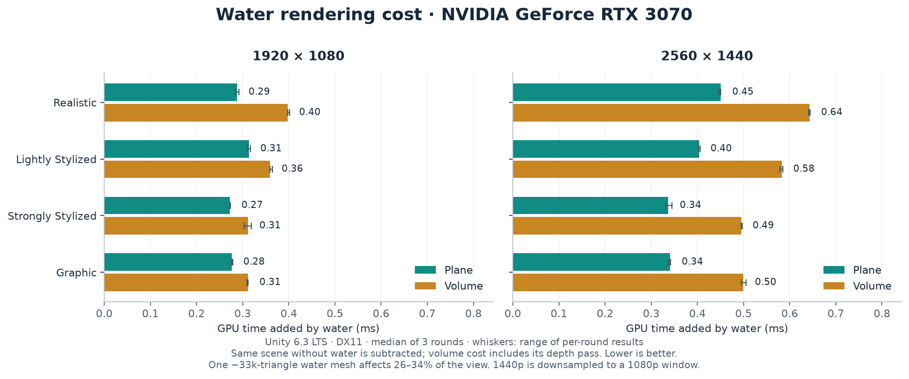

Each value is the median of three runs, with a matching no-water baseline subtracted from each run. Whiskers show the range across those runs. Full-scene GPU frame times at the 95th percentile ranged from **2.03–2.30 ms at 1080p** and **2.51–2.79 ms at 1440p**; those frame times include the background scene.

Benchmark setup

One animated water mesh with approximately 33,000 triangles, a ground plane, three submerged cubes, and one directional light. Water affected approximately 26–34% of the view. Each run used at least 120 warm-up frames and 300 unique GPU timing samples, with case order reversed on alternating runs. Timings came from Unity's Frame Timing Manager in a non-development player; debug views were captured separately.

Forward rendering with Render Graph enabled and VSync disabled. Depth and opaque textures were enabled in both the baseline and water cases; the opaque texture used 2× bilinear downsampling. HDR, MSAA, shadows, and post-processing were disabled. The 1080p pass used render scale 1; the 1440p pass rendered internally at 2560×1440 and was downsampled to a 1920×1080 window. The volume depth buffer's dimensions were checked against the internal resolution.

These measurements apply to this scene and hardware. Screen coverage, mesh density, lighting, overlapping transparent objects, and the target GPU affect rendering cost.

### Overdraw view

Unity's [URP Rendering Debugger](https://docs.unity3d.com/6000.0/Documentation/Manual/urp/features/rendering-debugger-reference.html) shows where visible draws overlap. These captures use a maximum overdraw count of 10. The water is mostly cyan, representing about two layers, with small three-layer regions around scene objects. There are no red high-overdraw regions in these examples.

| Plane | Volume |
| --- | --- |
| 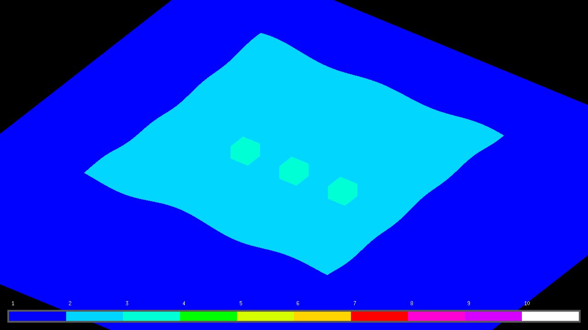 | 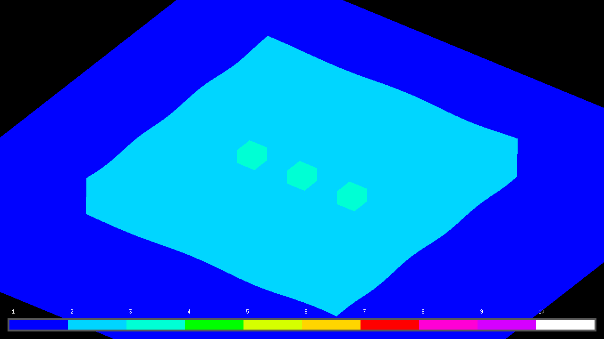 |

Overdraw colours count overlapping draws; they do not measure the instruction cost of the water shader. The GPU timings above include the water shading and the volume's additional depth pass.

## Import and use

1. Open a Unity 6 URP project with Render Graph enabled (Compatibility Mode disabled).
2. Import a package with **Assets → Import Package → Custom Package**.
3. Select the URP pipeline asset used by your project in its Graphics and Quality settings.
4. Choose **Water → Set Up Active URP Renderer**. This enables depth and opaque textures and installs the volume renderer support.
5. Assign a plane preset to a surface mesh, or a volume preset to a separate closed mesh. Put closed water renderers on **Water Volume / layer 30**. The mesh needs sufficient subdivisions for visible wave displacement.

The setup helper stops if layer 30 is already used by something else. In that case, configure a dedicated layer and the renderer feature's layer mask manually. Importing a package itself does not change project layers or assign a render pipeline; the setup menu applies those changes when invoked. Camera overrides must allow the depth and opaque textures used by the water.

For Graphs Only, create a material using `Water System/SG_Water_Plane` or `Water System/SG_Water_Volume` and configure its textures and effects in the Inspector.

## Supported use

- Refraction uses the opaque scene colour; transparent objects behind the water are not included in that texture.
- Volume water is intended for a camera outside separate, closed meshes. Underwater cameras and intersecting or overlapping volumes are not supported by this rendering path.
- Waves, foam, and caustics are visual effects, without fluid or buoyancy simulation.
- The recorded checks cover Windows. Mobile and XR performance have not been measured.

## Licence and credit

You may download, use, copy, modify, combine, and redistribute this water system **free of charge**, including in commercial projects. You can use it in a closed-source project, change the materials and graphs, or adapt it to your own work. No licence fee or royalty is charged.

**Commercial use requires visible credit to LazySakana.** This applies to paid games and applications, commercial asset distributions, client work, and videos or services monetized through sales, advertising, subscriptions, or other revenue. It also applies when you modify the water system or use it to make a commercial work without distributing its source files.

Put the credit in your project's credits or accompanying documentation. For a video, use its description or credits. A credit during gameplay is not required. Use this wording and link the name to the website where hyperlinks are supported:

> Water system by [LazySakana](https://lazysakana.co.in).

For **noncommercial use**, public credit is appreciated but optional. If the project becomes commercial, the credit requirement applies. When redistributing the water system itself, retain its copyright and licence notice. You do not have to publish your own project's source code.

The full conditions are in [LICENSE.md](LICENSE.md), and a copy is included in every package. This is a custom attribution licence, **not the MIT licence**. Unity and other third-party material retain their own terms.
